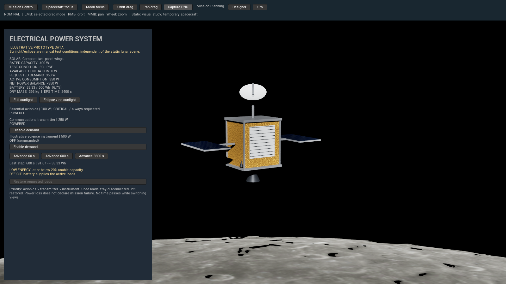
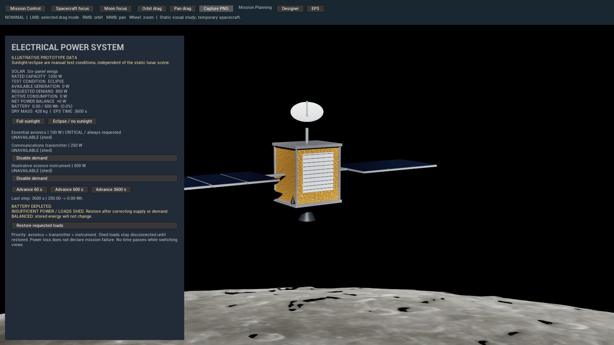

# Electrical Power System prototype

Task 5 starts from merged PR #5 (`30546ad`) on `codex/electrical-power-system`.
The installed spacecraft now drives a deterministic EPS model. All hardware ratings,
initial charge and warning thresholds below are **illustrative prototype data**, not
NASA specifications or approved mission requirements.

## Launch and operate

Use either `D:\GitHub\NOMINAL` (primary checkout) or `D:\GitHub\NOMINAL-Astra`
(agent checkout). Check out this feature branch and obtain Git LFS assets. From
PowerShell **inside the chosen checkout**:

```powershell
$project = Join-Path $PWD 'NOMINAL.uproject'
$engine = 'D:\Epic Games\UE_5.8'
git lfs pull
& "$engine\Engine\Build\BatchFiles\Build.bat" NOMINALEditor Win64 Development "-Project=$project" -WaitMutex -NoHotReloadFromIDE
& "$engine\Engine\Binaries\Win64\UnrealEditor.exe" $project -game -windowed -ResX=1600 -ResY=900
```

Adjust `$engine` for another installation. To open Unreal Editor instead, omit the
`-game` and window arguments. Open `/Game/LunarPrototype/L_LunarOrbit` and press Play.

- Mission Control has **Spacecraft Designer** and **Electrical Power System** buttons.
  The orbital toolbar also has **Designer** and **EPS**, so you can compare changes directly.
- In Designer, choose Power generation or Power storage and install an alternative.
  The battery is internal; existing solar, dish and propulsion visuals still work.
- In EPS, select **Full sunlight** or **Eclipse / no sunlight**. This changes an explicit
  test input only, not scene lighting, a spacecraft trajectory or calculated eclipse geometry.
- Use **Enable/Disable demand** for transmitter and instrument. Avionics is always
  requested and has no manual off switch.
- **Advance 60 / 600 / 3600 s** integrates that duration once. Waiting, camera movement
  and switching panels advance no EPS time. Values are real model outputs, not animations.
- If loads become unavailable after depletion, correct supply/demand and use
  **Restore requested loads**. It cannot power unsupported loads at zero stored energy.
- **Capture PNG** in the existing toolbar captures the actual scene and panel under
  `Saved/Screenshots/LunarView*.png`.

Configuration, energy, illumination, load commands, shedding state and elapsed EPS time
persist across panels within the current Play session. Restarting Play initializes a new
test session. There is no disk persistence or full time-warp system.

## Inputs and equations

Solar modules remain `power.wing6` (1200 W / 60 kg) and `power.wing2` (400 W / 25 kg).
The new `storage` slot accepts only the PowerStorage category:

| Module ID | Usable capacity | Dry mass |
| --- | ---: | ---: |
| `storage.500` (default) | 500 Wh | 20 kg |
| `storage.1000` | 1000 Wh | 35 kg |

The base bus remains 300 kg. Default spacecraft dry mass is now **428 kg**, including
the default battery; a large battery with default arrays yields **443 kg**. Compact
arrays with the default/large battery yield **393 / 408 kg** respectively. Dry mass
always sums bus plus installed modules. The battery is additional to the previous bus
allowance; there is no hidden second battery.

The load table is separate from UI formatting. `SetLoadWatts` supports validated
positive finite ratings for model callers; the player-facing prototype uses:

| Priority | ID | Illustrative constant demand | Control |
| ---: | --- | ---: | --- |
| 1 | `avionics` | 100 W | Critical, always requested |
| 2 | `transmitter` | 250 W | Switchable |
| 3 | `instrument` | 500 W | Switchable |

All three begin enabled, for 850 W requested demand. The instrument is a generic
electrical load only; no scientific activity or payload specifications are implemented.

For illumination factor `I = 1` in sunlight and `I = 0` in eclipse:

```text
P_rated [W] = sum of installed rated generation
P_generation [W] = I * P_rated
P_requested [W] = sum of ratings of commanded-on loads
P_active [W] = sum of ratings of powered (commanded-on and not shed) loads
P_net [W] = P_generation - P_active
delta_E [Wh] = P_net * delta_t [seconds] / 3600
E_next = clamp(E + delta_E, 0, C)
SOC [%] = 100 * E / C
```

Initial energy is 50% of installed usable capacity **once, at session creation**.
Usable capacity already represents the entire allowed energy interval; no additional
reserve, voltage curve or battery chemistry is modeled. Conversion and charge/discharge
efficiency are 100%, with no rate limits, self-discharge, degradation or thermal effects.
Solar power is ideal rated output under the selected test condition; no incidence,
distance, pointing or partial-shadow correction. Positive net power at full charge is
curtailed rather than stored beyond capacity. Displayed net power is available surplus
before curtailment, not battery terminal power.

### Depletion and availability

When `P_net < 0`, calculate `t_empty = 3600 * E / (-P_net)`. If an Advance crosses
that time, integrate exactly to zero, apply shedding, and integrate the remaining
duration with the new active demand. At zero energy, allocate available solar power
to whole loads in table priority order. No fractional powering is represented. If
avionics cannot be supplied, downstream loads are also unavailable. A load that does
not fit is disconnected; unused generation may charge the battery.

Shed state is latched across time steps, illumination changes and module updates.
This simple protection policy avoids oscillating automatic reconnects and dependence
on how the player partitions time. **Restore requested loads** clears the latch and
immediately reapplies the zero-energy supply check. If energy is positive, restoration
can use it; a continuing deficit can deplete it again. Disabling a load removes its
demand; enabling it does not bypass a latched trip. Restoring loads never adds energy.

Alerts report energy at/below an illustrative 20% threshold, depletion, deficit and
unavailable requested loads. Requested demand is displayed separately from actually
powered consumption so shedding cannot hide the unmet demand. Avionics can be
unavailable despite always being requested. EPS never changes the mission phase or
declares failure; the operator can inspect and correct conditions even with avionics off.

Integration uses double precision with a 1 ns comparison tolerance at the depletion
boundary. Invalid/nonfinite/negative time inputs and invalid ratings are rejected.
Zero time is a no-op. Equivalent total durations are tested with floating-point tolerance.

### Configuration changes and anti-recharge policy

Only Planning and Spacecraft Design permit installs. Starting with Launch Preparation,
the UI disables installation and the session API independently rejects it, including
in flight and terminal states. This does not modify the existing lifecycle transitions.

When allowed, replacement applies `E_new = min(E_old, C_new)` and updates installed
generation/capacity immediately. Larger capacity brings **no new energy**; smaller
capacity discards any excess, which cannot be recovered by swapping back. Even repeated
installation or synchronization cannot refill the battery. Initial 50% charge is never
reapplied. For this abstract design exercise, remaining Wh is carried into the revised
design, not modeled as physically exchanging charged flight packs.

## Architecture and scope

`FElectricalPowerSystem` is a plain C++ value model using Core types, independent of
Slate, world/tick, rendering and mission outcomes. `FSpacecraftConfiguration` supplies
installed rated power and battery capacity; it still owns IDs rather than simulation
state. `AMissionControlGameMode` owns one EPS alongside the spacecraft and lifecycle,
enforces design locks and synchronizes successful installs. `SElectricalPowerPanel`
reads that model and submits explicit commands. No duplicated UI state machine.

No new assets, plugins, dependencies or project configuration. Existing lunar assets,
camera, presentation adapter and Mission Core remain unchanged. Battery internals
have no new external geometry. There is no trajectory, eclipse geometry, detailed
electronics, destruction, budget, random fault or science simulation in this change.

## Validation

Build and automated validation on 2026-11-02:

- UE 5.8.4 Win64 Development `NOMINALEditor`: passed. An initial generated-constructor
  initialization compile error was corrected before the successful build.
- Entire NOMINAL suite: **11 passed, 0 failed, 0 test warnings**, command exit code 0.
  Five EPS tests cover energy/loads, depletion/recovery, module replacement,
  duration equivalence and session/flight lock. All six previous lifecycle, camera
  and designer tests pass with mass expectations updated for the default battery.
- Duration comparisons include 0.5, 60 and 600 second subdivisions, exact depletion,
  crossing depletion, and reaching full charge; comparisons include load availability.

Executed test command (after the launch variables above):

```powershell
& "$engine\Engine\Binaries\Win64\UnrealEditor-Cmd.exe" $project '-ExecCmds=Automation RunTests NOMINAL.;Quit' '-TestExit=Automation Test Queue Empty' -unattended -nop4 -NullRHI "-ReportExportPath=$PWD\Saved\Automation\EPS" '-log=EPSTests.log'
```

Local reports/logs are ignored under `Saved/Automation/EPS` and `Saved/Logs`.
MSVC 14.52 is newer than UE's preferred 14.50 and produced the existing build warning.
Generic startup automation `Condition failed` messages occurred before the selected
tests; the exported test report contains no test errors. The SDK scan warns about
missing non-Windows SDKs; only Win64 was built.

### Actual in-game verification

Verified in the Win64 Development game window on November 2–3, 2026 at 1600x900.
These are actual engine captures, not mockups. A–D were performed sequentially in
one fresh session, initially 250 Wh / 500 Wh, with 850 W requested demand.

| Scenario | Generation / active load | Step | Stored energy before → after |
| --- | --- | --- | --- |
| A: large arrays, sunlight | 1200 / 850 W | 600 s | 250.00 → 308.33 Wh |
| B: install compact arrays | 400 / 850 W | 600 s | 308.33 → 233.33 Wh |
| C: eclipse | 0 / 850 W | 600 s | 233.33 → 91.67 Wh; low-energy alert |
| D: disable instrument in eclipse | 0 / 350 W | 600 s | 91.67 → 33.33 Wh |

The compact-array installation visibly changed the solar geometry and reduced dry
mass to 393 kg without resetting energy. Switching panels did not advance EPS time.




A separate fresh session verified depletion: eclipse plus 3600 s reduced 250 Wh
to zero and made all three loads unavailable. Mission Planning remained unchanged.
Restoring sunlight alone left protection latched; Restore requested loads powered
all three consumers. A 600 s advance charged to 58.33 Wh. Installing the 1000 Wh
battery then changed mass to 443 kg and capacity to 1000 Wh while preserving
58.33 Wh and elapsed time of 4200 s.




Flight-phase installation rejection was verified by automation, not a separate
manual UI run. PIE, packaged/Shipping builds and other platforms were not tested.
The existing spacecraft geometry remains temporary; this task makes no photorealism
or validated hardware claim. No lunar lighting, assets, maps or engine configuration
were changed. Illumination remains manual and independent of scene geometry.

## Changed files

- `Source/NOMINAL/Public/Spacecraft/ElectricalPowerSystem.h` and
  `Private/Spacecraft/ElectricalPowerSystem.cpp`: independent EPS model.
- `Source/NOMINAL/Private/Spacecraft/SElectricalPowerPanel.h` and `.cpp`: interactive EPS panel.
- `Source/NOMINAL/Public/Spacecraft/SpacecraftConfiguration.h` and
  `Private/Spacecraft/SpacecraftConfiguration.cpp`: storage slot, modules and capacity sum.
- `Source/NOMINAL/Public/Mission/MissionControlGameMode.h` and
  `Private/Mission/MissionControlGameMode.cpp`: session ownership, navigation and refit guard.
- `Source/NOMINAL/Private/Spacecraft/SSpacecraftDesigner.h` and `.cpp`: battery selection and lock display.
- `Source/NOMINAL/Private/Tests/ElectricalPowerSystemTests.cpp`: five EPS automation tests.
- `Source/NOMINAL/Private/Tests/SpacecraftConfigurationTests.cpp`: battery-inclusive mass expectations.
- `Docs/electrical-power-system.md`: equations, assumptions, launch and validation.
- `Docs/spacecraft-designer-prototype.md`: pointer from historical Task 4 data to current EPS behavior.
- `Docs/Images/eps-sunlight.png`, `eps-deficit.png`, `eps-eclipse.png`,
  `eps-reduced-load.png`, `eps-depleted.png`, `eps-recovery-battery-swap.png`: actual captures.

The Master Design Document is unchanged.
