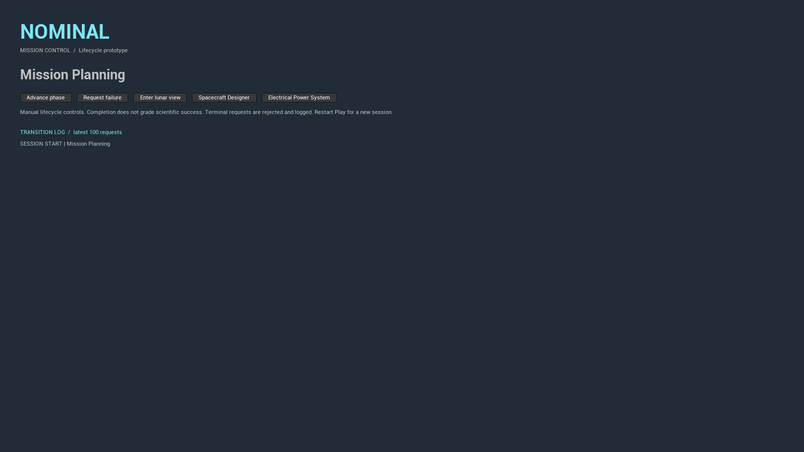
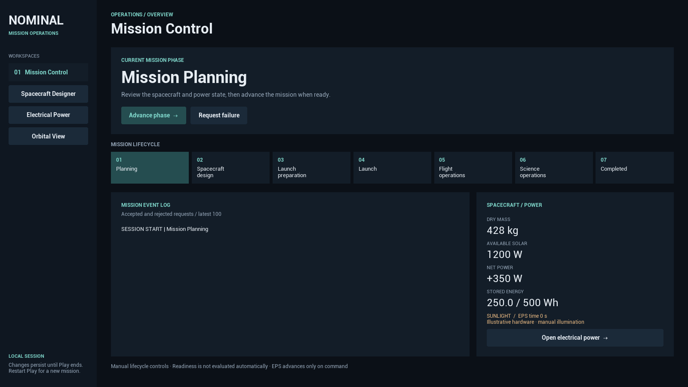

# Mission Control visual polish — Phase 1

Focused presentation pass from main `b5cc9e5` (merged EPS PR #6). The existing EPS
branch remains preserved. No simulation, lifecycle rules, configuration logic,
Unreal assets, scene lighting or project settings changed.

The new Slate dashboard adds a consistent dark palette, restrained teal accents,
clear typography, workspace navigation, a prominent current phase, lifecycle strip,
scrollable event log and live readouts from the existing spacecraft/EPS session.
All commands call the existing GameMode methods. Readouts do not advance time.
Fonts and brushes use built-in Unreal functionality; no external dependencies.

## Actual game captures

Both images show a fresh Planning session at 1600x900, captured by Unreal's
`Shot SHOWUI` command. Startup debug messages were suppressed for both captures.




## Validation — November 4, 2026

- UE 5.8.4 `NOMINALEditor Win64 Development` build passed. An initial Slate bracket
  compile error was fixed; the final build passed. Existing MSVC 14.52 preferred-version
  warning remains (UE prefers 14.50).
- Entire existing NOMINAL suite: **11 passed, 0 failed, 0 test warnings**; exit 0.
- Actual game: phase advancement updates title, lifecycle highlight and log;
  Designer/EPS/Orbital navigation and return preserve the session. Installing compact
  arrays updates the dashboard to 393 kg, 400 W and -450 W. Advancing EPS 600 s
  updates stored energy to 175 Wh and elapsed time to 600 s.
- Requested failure displays a distinct terminal state. Advancing afterward keeps
  Failed and logs the rejected request.
- Visually inspected at 1600x900 and 1280x720. Button labels remain on one line;
  the main area scrolls when needed. Stepped through all six advances to Completed
  in the smaller window; the title, phase highlight and log updated correctly.
- PIE, packaged builds, controller input and non-Windows platforms were not tested.

## Launch and checks

From either `D:\GitHub\NOMINAL` or `D:\GitHub\NOMINAL-Astra`, check out
`codex/mission-control-visual-polish`, then run in PowerShell (adjust engine path):

```powershell
$project = Join-Path $PWD 'NOMINAL.uproject'
$engine = 'D:\Epic Games\UE_5.8'
git lfs pull
& "$engine\Engine\Build\BatchFiles\Build.bat" NOMINALEditor Win64 Development "-Project=$project" -WaitMutex -NoHotReloadFromIDE
& "$engine\Engine\Binaries\Win64\UnrealEditor.exe" $project -game -windowed -ResX=1600 -ResY=900
```

The game opens directly into Mission Control. Sidebar buttons open the existing
workspaces; their Mission Control toolbar button returns to the dashboard.

The full test suite was run with:

```powershell
& "$engine\Engine\Binaries\Win64\UnrealEditor-Cmd.exe" $project '-ExecCmds=Automation RunTests NOMINAL.;Quit' '-TestExit=Automation Test Queue Empty' -unattended -nop4 -NullRHI "-ReportExportPath=$PWD\Saved\Automation\VisualPolishFinal" '-log=VisualPolishFinalTests.log'
```

Changed code: `MissionControlGameMode.cpp` (construct the dashboard), and new
`SMissionControlDashboard.h/.cpp` (presentation only), all under
`Source/NOMINAL/Private/Mission`. Other changes are this note and the two captures.

Designer/EPS styling and lunar/spacecraft visual improvements remain for later
focused passes. Existing spacecraft assets are still placeholders.
