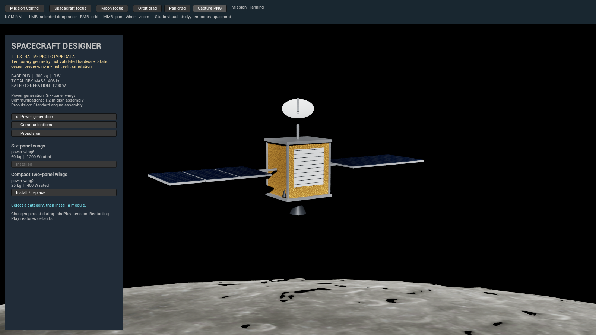
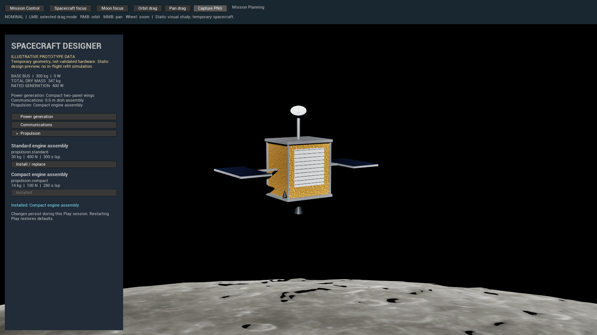

# Modular spacecraft designer prototype

Task 4 builds on merged PR #4 (`80495b4`) and preserves Mission Core, Mission Control,
the lunar scene and the existing camera. No external assets, plugins or dependencies
were added. The master design document is unchanged.

## Launch locally

Use either checkout: the user's primary `D:\GitHub\NOMINAL` or the agent's
`D:\GitHub\NOMINAL-Astra`. From PowerShell **inside the chosen checkout**, after
checking out `codex/modular-spacecraft-designer` and fetching its Git LFS assets:

```powershell
$project = Join-Path (Get-Location) 'NOMINAL.uproject'
$engine = 'D:\Epic Games\UE_5.8'
& "$engine\Engine\Build\BatchFiles\Build.bat" NOMINALEditor Win64 Development "-Project=$project" -WaitMutex -NoHotReloadFromIDE
& "$engine\Engine\Binaries\Win64\UnrealEditor.exe" $project
```

Adjust only `$engine` if UE is installed elsewhere. Open `/Game/LunarPrototype/L_LunarOrbit`
if another map is selected, then Play. Alternatively, the standalone editor game
mode used for visual verification is:

```powershell
& "$engine\Engine\Binaries\Win64\UnrealEditor.exe" $project -game -windowed -ResX=1600 -ResY=900 -nosplash
```

1. In Mission Control, click **Spacecraft Designer**.
2. Select Power generation, Communications or Propulsion. Each shows two compatible
   modules and their specifications. Click **Install / replace**.
3. Observe the mesh change, installed labels and calculated totals. An installed
   option is disabled; a different option replaces it rather than accumulating parts.
4. Use the existing canvas controls: RMB orbit, MMB pan, wheel zoom, or select
   Orbit drag/Pan drag and use LMB. Buttons and the sidebar do not rotate the camera.
5. Click **Mission Control**, then reopen **Spacecraft Designer**. The same configuration
   remains. **Enter lunar view** also displays the configured spacecraft without the panel.
6. **Capture PNG** writes `Saved/Screenshots/LunarView0000n.png` including the UI.

Configuration lasts for the current Play session only. Restarting Play restores defaults.
The designer is a static preview accessible independently of the manual lifecycle controls;
it is not an in-flight refit mechanic or a mission feasibility check.

## Illustrative data, not approved mission hardware

One fixed prototype bus contributes 300 kg dry mass and 0 W generation. There is one
attachment slot per category; replacing an assembly replaces the complete category.
The mass of fixed visual fittings is included in the illustrative bus allowance.

| Stable module ID | Category | Mass kg | Relevant illustrative specification |
| --- | --- | ---: | --- |
| `power.wing6` | Power | 60 | 1200 W rated generation |
| `power.wing2` | Power | 25 | 400 W rated generation |
| `comms.dish12` | Communications | 18 | 1.2 m dish diameter |
| `comms.dish06` | Communications | 8 | 0.6 m dish diameter |
| `propulsion.standard` | Propulsion | 30 | 400 N thrust; 300 s specific impulse |
| `propulsion.compact` | Propulsion | 14 | 100 N thrust; 280 s specific impulse |

Defaults are the first module listed in each category, selected explicitly by slot ID:
**408 kg / 1200 W**. All compact alternatives yield **347 kg / 400 W**.
Totals sum the base bus and installed modules. They do not measure current illumination,
electrical consumption, fuel, wet mass, delta-v, link performance or hardware feasibility.
No relationship between mesh dimensions and engineering performance is asserted.

## Implementation and extension points

- `FSpacecraftCatalog`: immutable module and slot definitions, separate from UI and visuals.
- `FSpacecraftConfiguration`: value-owned slot-to-module IDs, deterministic initialization,
  compatibility validation and derived totals. Unknown IDs, wrong categories and invalid
  numeric specifications are rejected before mutation. Independent instances and copies
  have independent installed state.
- `AMissionControlGameMode`: owns one configuration for the local session alongside the
  unchanged `FMissionLifecycle`; switching panels does not replace either object.
- `SSpacecraftDesigner`: follows catalog slots/categories and submits installs through the
  session. The UI filters compatible options; validation remains in the data layer.
- `FSpacecraftPresentation`: applies visual-only profiles to runtime actor tags. Compact
  power hides the outer four panel pairs (frame + cell surface), the small dish rescales
  the existing dish/feed, and the compact engine narrows nozzle/mount. Every application
  starts from cached authored transforms, so swaps are reversible without scale drift.

The level change adds five role tags across 16 existing actors only. No meshes,
materials, textures, lighting, exposure or camera code were changed. The focused
`Scripts/tag_spacecraft_parts.py` commandlet was run; the full lunar generator was
**not** run. Its source now reapplies the same tags for future reproducibility.
Adding future categories requires a catalog slot/definition and corresponding visual
profile; new engineering systems should supply their own calculations. Multiple bus
types, attachment placement, collision constraints and save-game serialization remain
future architecture decisions.

## Validation performed on 2026-11-01

- UE **5.8.4**, Win64 Development **NOMINALEditor** build: succeeded, including the final
  engine profile correction. MSVC 14.52 is newer than UE's preferred 14.50; build emitted
  that toolchain warning.
- Six automated tests: **6 passed, 0 failed, 0 test warnings**, command exit code 0:
  `NOMINAL.MissionCore.TransitionMatrix`, `NOMINAL.MissionCore.OperationsAndIsolation`,
  `NOMINAL.LunarView.CameraBounds`, `NOMINAL.Spacecraft.Configuration`,
  `NOMINAL.Spacecraft.SessionNavigation`, `NOMINAL.Spacecraft.VisualProfiles`.
- Tests cover all 18 slot/module combinations, unknown IDs, numeric validity, replacement,
  totals, repeated installation, independent configurations/copies, session navigation,
  lifecycle/log retention, missing visual bindings, repeated profiles and original transform restoration.
- Actual standalone Unreal game launched with the existing lunar map. Visually verified
  solar, dish and engine changes, updated totals, return/reopen persistence, lifecycle
  advance/log, orbit, pan, zoom, Moon focus and spacecraft focus. Sidebar clicks did not
  move the camera. Restarting the game restored defaults.
- Screenshots below are actual game captures, not generated illustrations.

Tests were executed with:

```powershell
& "$engine\Engine\Binaries\Win64\UnrealEditor-Cmd.exe" $project '-ExecCmds=Automation RunTests NOMINAL.;Quit' '-TestExit=Automation Test Queue Empty' -unattended -nop4 -NullRHI "-ReportExportPath=$PWD\Saved\Automation\DesignerFinal" '-log=DesignerTestsFinal.log'
```

The exported report is in ignored `Saved/Automation/DesignerFinal/index.json`.
Unreal emitted generic `Condition failed` automation messages during startup, before
the selected tests began; none were attached to these six tests in the report.
The platform SDK scan also reported unavailable non-Windows SDKs; this task only built Win64.
PIE, packaged/Shipping builds, other platforms, multiplayer, gamepad and alternate screen
resolutions were not tested. The UI navigation automation tests exercise session methods;
real Slate navigation was checked manually in the running game.

## Actual screenshots and remaining visual limitations

Default configuration (408 kg / 1200 W):



Compact configuration (347 kg / 400 W):



Spacecraft components remain temporary primitives with simplified and sometimes visibly
separated attachments. Undersides can be dark under the existing directional lighting.
The inherited lunar grazing-angle artifacts remain. This is a functional designer
prototype, not a claim of photorealism or validated spacecraft engineering.

## Changed files

- `Content/LunarPrototype/L_LunarOrbit.umap`
- `Source/NOMINAL/Public/Spacecraft/SpacecraftConfiguration.h`
- `Source/NOMINAL/Private/Spacecraft/SpacecraftConfiguration.cpp`
- `Source/NOMINAL/Public/Spacecraft/SpacecraftPresentation.h`
- `Source/NOMINAL/Private/Spacecraft/SpacecraftPresentation.cpp`
- `Source/NOMINAL/Private/Spacecraft/SSpacecraftDesigner.h`
- `Source/NOMINAL/Private/Spacecraft/SSpacecraftDesigner.cpp`
- `Source/NOMINAL/Public/Mission/MissionControlGameMode.h`
- `Source/NOMINAL/Private/Mission/MissionControlGameMode.cpp`
- `Source/NOMINAL/Private/Tests/SpacecraftConfigurationTests.cpp`
- `Scripts/tag_spacecraft_parts.py`
- `Scripts/build_lunar_level.py`
- `Docs/spacecraft-designer-prototype.md`
- `Docs/Images/designer-default.png`
- `Docs/Images/designer-compact.png`
